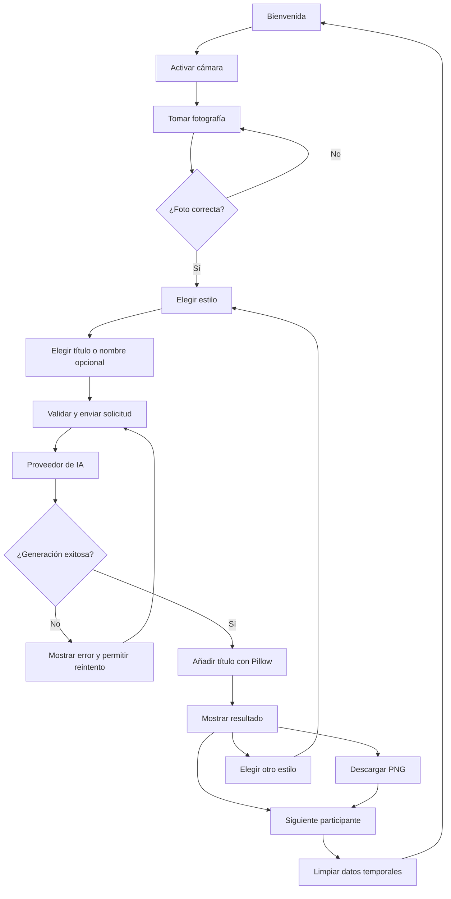

# SPEC.md — Aplicación de transformación de rostros con IA

**Proyecto:** Prototipo interactivo para feria universitaria  
**Versión:** 1.1  
**Estado:** Planificación  
**Plazo objetivo:** 1 día de desarrollo  
**Stack principal:** Python + Flask + HTML/CSS/JavaScript  
**Proveedor inicial:** Cloudflare Workers AI (candidato; se confirma o descarta en la Fase 0, ver `docs/PROVIDER_VALIDATION.md`)  
**Proveedor objetivo:** API de generación de imágenes de Gemini

---

## 0. Jerarquía de documentos

| Documento | Responde a | Contenido |
|---|---|---|
| `SPEC.md` | ¿Qué y por qué? | Alcance, requisitos, privacidad, riesgos (este documento). |
| `docs/PLAN.md` | ¿Cómo? | Decisiones técnicas, variables de entorno, decisiones abiertas. |
| `docs/API.md` | ¿Qué contrato? | Rutas, campos, límites, códigos de error. |
| `docs/PROMPTS.md` | ¿Qué se le pide a la IA? | Prompts de los ocho estilos y rúbrica de evaluación. |
| `docs/UI_COPY.md` | ¿Qué dice la interfaz? | Textos de pantallas y mensajes de error. |
| `docs/PROVIDER_VALIDATION.md` | ¿Sirve el proveedor? | Resultado de la Fase 0 (puerta de control). |
| `TASKS.md` | ¿En qué orden? | Plan de ejecución por fases, único plan del proyecto. |
| `docs/TEST_PLAN.md` | ¿Cómo se verifica? | Pruebas automáticas, escenarios y ensayo general. |
| `docs/RUNBOOK.md` | ¿Cómo se opera en la feria? | Guía del operador y contingencias. |

**Precedencia ante conflictos:** `SPEC.md` > `docs/PLAN.md` > `docs/API.md`, `docs/PROMPTS.md`, `docs/UI_COPY.md` > `TASKS.md`. Un conflicto se reporta y se corrige en el documento, no se resuelve en silencio en el código.

---

## 1. Constitución del proyecto

### 1.1 Propósito

Construir una aplicación web sencilla e interactiva para una feria universitaria dirigida a niños y niñas de escuelas. La aplicación permitirá tomar una fotografía mediante una cámara web conectada al computador del profesor, elegir una transformación fantástica y generar una imagen en la que el niño o niña aparezca como un personaje.

La experiencia debe ser divertida, rápida, visualmente atractiva y fácil de reiniciar para atender al siguiente participante.

### 1.2 Objetivo principal

Desarrollar en un día un prototipo funcional que capture una fotografía, permita elegir entre al menos ocho estilos de personaje, genere una imagen transformada mediante un proveedor de IA y permita descargarla, con opción de colocar un título genérico o un nombre personalizado.

### 1.3 Usuarios

- **Participante:** niño o niña que elige el personaje y observa el resultado.
- **Operador:** profesor o estudiante encargado de ayudar, controlar la cámara y resolver incidencias.
- **Desarrollador:** estudiante que implementa, prueba y despliega el prototipo.

### 1.4 Principios de desarrollo

1. **MVP primero:** priorizar un flujo completo y funcional antes que características adicionales.
2. **Integración temprana:** comprobar el proveedor de imágenes con una foto de prueba al principio del desarrollo.
3. **Arquitectura intercambiable:** desacoplar el proveedor de IA para facilitar la migración a Gemini.
4. **Experiencia sencilla:** botones grandes, instrucciones cortas y pocos pasos.
5. **Privacidad por defecto:** minimizar la captura, transmisión, almacenamiento y retención de fotografías.
6. **Degradación controlada:** mostrar errores comprensibles y permitir reintentar; preparar imágenes de demostración no personales como contingencia.
7. **Sin complejidad innecesaria:** no implementar cuentas, base de datos, analítica ni panel administrativo para el MVP.

### 1.5 Fuera del alcance inicial

- Registro o inicio de sesión.
- Base de datos de niños o participantes.
- Galería pública de fotografías.
- Reconocimiento de identidad.
- Entrenamiento o ajuste fino de modelos.
- Aplicación móvil nativa.
- Impresión física.
- Generación de códigos QR, salvo que quede tiempo después de cumplir el MVP.
- Garantía de preservar perfectamente la identidad facial: el resultado depende del modelo y debe evaluarse.

---

## 2. Alcance funcional

### 2.1 Funciones obligatorias

- [ ] Mostrar una pantalla de bienvenida.
- [ ] Acceder a la cámara web desde el navegador.
- [ ] Tomar una fotografía.
- [ ] Mostrar una vista previa y permitir repetir la captura.
- [ ] Permitir elegir entre ocho o más transformaciones.
- [ ] Enviar la fotografía y el prompt correspondiente al proveedor de IA.
- [ ] Mostrar un estado de carga mientras se procesa la imagen.
- [ ] Mostrar la imagen generada.
- [ ] Añadir un título genérico o un nombre personalizado sobre la imagen final.
- [ ] Descargar la imagen final en PNG.
- [ ] Permitir volver a elegir otro personaje con la fotografía actual.
- [ ] Reiniciar la experiencia para el siguiente participante.
- [ ] Manejar errores de cámara, red, proveedor y formato de respuesta.
- [ ] Limpiar los datos temporales al terminar o reiniciar la experiencia.
- [ ] Ofrecer un modo demostración (`IMAGE_PROVIDER=mock`) con imágenes sintéticas no personales.

### 2.2 Funciones opcionales

Solo se implementarán si todas las funciones obligatorias están terminadas y probadas:

- [ ] Animación de revelación del personaje.
- [ ] Descargar con un nombre de archivo personalizado y seguro.
- [ ] Código QR para recuperar la imagen.
- [ ] Selector de intensidad de transformación.
- [ ] Interfaz de administración de estilos.

---

## 3. Catálogo de transformaciones

La aplicación debe ofrecer, como mínimo, las siguientes ocho opciones. Cada estilo tendrá un identificador, una etiqueta visible, un título predeterminado y un prompt.

| ID | Estilo | Título predeterminado |
|---|---|---|
| `superhero` | Superhéroe | Capitán Valiente |
| `royalty` | Princesa o príncipe | Realeza de Fantasía |
| `astronaut` | Astronauta | Capitán Espacial |
| `explorer` | Explorador de aventuras | Explorador de Mundos |
| `wizard` | Mago o maga | Maestro de la Magia |
| `inventor` | Inventor futurista | Genio del Futuro |
| `knight` | Caballero o guardiana | Guardián del Reino |
| `ocean` | Explorador submarino | Capitán del Océano |

### Reglas del catálogo

- El género del participante no debe restringir qué estilos puede elegir.
- Los títulos predeterminados son únicos por estilo y editables por configuración.
- Los prompts deben pedir un resultado infantil, amable y apropiado para una feria escolar.
- Se debe pedir conservar los rasgos faciales reconocibles, la edad aparente, el tono de piel y la expresión, sin prometer que el modelo lo hará perfectamente.
- El texto del título se añadirá con código después de generar la imagen; no se dependerá de la IA para escribir correctamente el nombre.
- Los prompts se almacenarán fuera de las rutas de Flask (`data/transformations.py`) para poder modificarlos sin alterar la lógica. Su redacción y evaluación se documentan en `docs/PROMPTS.md`.

---

## 4. Flujo de usuario

1. El operador abre la aplicación.
2. La pantalla de bienvenida presenta la actividad.
3. El operador o participante pulsa **Empezar**.
4. El navegador solicita permiso para utilizar la cámara.
5. El participante se coloca frente a la cámara.
6. Pulsa **Tomar foto**.
7. La aplicación muestra una vista previa con las opciones **Repetir** y **Continuar**.
8. Se selecciona uno de los ocho estilos.
9. Opcionalmente, se introduce un nombre; si no, se usa el título predeterminado.
10. Se pulsa **Transformarme**.
11. Flask valida la solicitud y llama al proveedor configurado.
12. Se muestra un indicador de procesamiento y, al finalizar, la imagen resultante.
13. El compositor añade el título elegido.
14. El usuario puede descargar la imagen, probar otro estilo o terminar.
15. Al pulsar **Siguiente participante**, la aplicación elimina referencias y archivos temporales de la sesión y vuelve al inicio.

### Diagrama



---

## 5. Arquitectura técnica

### 5.1 Tecnologías

| Componente | Tecnología | Responsabilidad |
|---|---|---|
| Backend | Python + Flask | Rutas, validación y coordinación del flujo |
| Interfaz | HTML, CSS y JavaScript | Pantallas, cámara, selección y estados de carga |
| Cámara | `navigator.mediaDevices.getUserMedia()` | Acceso a la webcam desde el navegador |
| Captura | `canvas` del navegador | Convertir el fotograma en una imagen |
| HTTP | `requests` | Llamadas al proveedor de IA |
| Composición | Pillow | Añadir título, marco y exportar PNG |
| Configuración | `python-dotenv` | Leer secretos desde `.env` |
| Pruebas | `pytest` | Verificar catálogo, validación y composición |
| Proveedor inicial | Adaptador configurable | Generación de imágenes durante pruebas |
| Proveedor objetivo | Gemini API | Generación/edición de imágenes tras migración |

**Nota sobre la cámara:** el acceso a `getUserMedia()` requiere normalmente un contexto seguro: HTTPS o `localhost`. Probar en el computador, navegador y webcam que se usarán en la feria. La cámara la controla el navegador; Flask no accede directamente al dispositivo.

### 5.2 Arquitectura lógica

```text
Navegador
  ├── Cámara y captura
  ├── Selección de estilo
  ├── Campo de nombre
  ├── Vista previa y descarga
  └── Peticiones HTTP
          |
          v
Flask
  ├── Validación de entrada
  ├── Catálogo de transformaciones
  ├── Selección del proveedor
  ├── Servicio de generación
  ├── Composición del título
  └── Respuesta de imagen
          |
          v
ImageGenerator (interfaz común)
  ├── MockProvider (pruebas y modo demostración)
  ├── CloudflareProvider
  └── GeminiProvider
```

### 5.3 Estructura de carpetas propuesta

```text
feria_ia/
├── app.py
├── config.py
├── requirements.txt
├── .env.example
├── .gitignore
├── README.md
├── SPEC.md
├── TASKS.md
├── AGENTE_DESARROLLADOR.md
├── CLAUDE.md                  # importa AGENTE_DESARROLLADOR.md (si se usa Claude Code)
├── docs/
│   ├── PLAN.md
│   ├── API.md
│   ├── PROMPTS.md
│   ├── UI_COPY.md
│   ├── PROVIDER_VALIDATION.md
│   ├── TEST_PLAN.md
│   └── RUNBOOK.md
├── services/
│   ├── __init__.py
│   ├── image_generator.py     # interfaz común
│   ├── provider_factory.py
│   ├── mock_provider.py       # pruebas y modo demostración
│   ├── cloudflare_provider.py
│   ├── gemini_provider.py     # Fase 10
│   └── image_composer.py
├── data/
│   └── transformations.py
├── templates/
│   └── index.html
├── static/
│   ├── css/styles.css
│   ├── js/
│   │   ├── camera.js          # stream, captura, detener pistas
│   │   └── app.js             # pantallas, estado, peticiones, limpieza
│   └── assets/
│       ├── icons/
│       └── fonts/             # tipografía con licencia libre
└── tests/
    ├── test_transformations.py
    ├── test_image_composer.py
    ├── test_provider_factory.py
    ├── test_routes.py
    └── test_privacy.py
```

No es obligatorio crear todos los archivos desde el primer minuto. Mantener esta separación solo si ayuda a trabajar con rapidez; evitar abstracciones innecesarias.

---

## 6. Contrato del proveedor de imágenes

### 6.1 Interfaz común

Todos los proveedores deben ofrecer una operación equivalente:

```python
class ImageGenerator:
    def generate(self, image_bytes: bytes, prompt: str) -> bytes:
        """Devuelve los bytes de una imagen generada."""
        raise NotImplementedError
```

El contrato real puede ampliarse con parámetros de tamaño o relación de aspecto si ambos proveedores lo permiten. La aplicación no debe depender de la estructura interna de la respuesta de un proveedor concreto.

### 6.2 Selección de proveedor

Se seleccionará mediante una variable de entorno:

```dotenv
IMAGE_PROVIDER=cloudflare
```

Después de verificar y configurar Gemini:

```dotenv
IMAGE_PROVIDER=gemini
```

Valores admitidos: `cloudflare`, `gemini` y `mock`. `mock` ignora la fotografía y devuelve una imagen sintética no personal: sirve como doble de pruebas y como modo demostración. La factoría construirá el adaptador elegido. No se deben colocar claves API en JavaScript, HTML, el repositorio ni mensajes de error.

### 6.3 Proveedor gratuito de pruebas: condición de entrada

Cloudflare Workers AI es el candidato inicial, sujeto a comprobar la disponibilidad real del modelo de edición de imágenes, el formato de entrada y salida, la cuota gratuita vigente y el coste por generación en la cuenta utilizada.

Antes de construir la integración completa:

1. Crear o verificar la cuenta.
2. Revisar la documentación oficial del modelo concreto.
3. Confirmar si el endpoint admite una imagen de entrada y edición guiada por prompt.
4. Confirmar el formato de la solicitud y de la respuesta.
5. Hacer una llamada con una imagen de prueba no personal.
6. Registrar latencia, resultado visual y consumo de cuota.
7. Si el endpoint no está disponible o no preserva suficientemente el rostro, evaluar Gemini o una alternativa antes de continuar.

**No asumir que cualquier modelo de texto a imagen admite edición de una foto existente.** El caso de uso requiere generación condicionada por imagen o una técnica explícita de edición.

### 6.4 Migración a Gemini

- Implementar un adaptador independiente en `gemini_provider.py`.
- Usar el SDK oficial de Google Gen AI para Python y la documentación vigente de generación/edición de imágenes.
- Leer la clave desde una variable de entorno.
- Convertir la respuesta del SDK a bytes de imagen.
- Gestionar respuestas sin imagen, límites de uso, errores HTTP y tiempos de espera.
- Verificar modelo disponible, modalidad de entrada, condiciones de uso, precio y cuota antes de usarlo con participantes.
- Mantener la misma interfaz para no cambiar las rutas ni la interfaz web.

Documentación oficial:
- Cloudflare Workers AI: https://developers.cloudflare.com/workers-ai/
- Gemini API, generación de imágenes: https://ai.google.dev/gemini-api/docs/image-generation
- Google Gen AI SDK para Python: https://googleapis.github.io/python-genai/

---

## 7. Procesamiento de imágenes y título

### 7.1 Entrada

La aplicación debe aceptar únicamente formatos de imagen admitidos, limitar el tamaño de la solicitud y verificar que el contenido realmente sea una imagen. No confiar exclusivamente en la extensión o el MIME declarado por el navegador.

Valores iniciales sugeridos para probar:
- Tamaño máximo de fotografía: 8 MB.
- Formatos aceptados: JPEG, PNG o WebP.
- Resolución de entrada: reducirla a un tamaño razonable si el proveedor lo requiere.
- Orientación: corregir orientación EXIF cuando proceda.

Estos valores son límites iniciales configurables, no requisitos del proveedor.

### 7.2 Composición final

Pillow será responsable de:
1. Abrir la imagen devuelta por el proveedor.
2. Convertirla a un modo compatible con PNG.
3. Reservar una franja o colocar una tarjeta de título sin cubrir el rostro.
4. Dibujar el título con una fuente legible y compatible con caracteres españoles.
5. Ajustar el texto a una longitud máxima.
6. Exportar la imagen final como PNG.

El título se determina así:
- Si el campo de nombre está vacío, usar el título predeterminado del estilo.
- Si hay un nombre válido, formar el título `«{nombre}, {título predeterminado}»`, sin modificarlo mediante IA.
- La franja del título se añade **debajo** de la imagen (el lienzo crece), de modo que nunca cubre el rostro.
- El nombre es texto opcional y no se usa como identificador de sesión ni como nombre de archivo por defecto.

### 7.3 Descarga

- Mostrar un botón **Descargar imagen** solo cuando exista una imagen final.
- La descarga debe ser PNG.
- El nombre del archivo debe ser seguro, por ejemplo `mi_personaje.png`.
- No guardar una galería persistente en el servidor.
- Revocar URLs de objetos del navegador y limpiar los elementos de la sesión al reiniciar.

---

## 8. Rutas HTTP propuestas

| Método y ruta | Función |
|---|---|
| `GET /` | Renderizar la interfaz |
| `GET /api/transformations` | Devolver catálogo de estilos |
| `POST /api/generate` | Recibir fotografía, estilo y nombre opcional; generar y componer |
| `GET /api/health` | Comprobación básica de la aplicación |

**Decisión:** el servidor no mantiene estado de sesión. La fotografía vive solo en la memoria del navegador y la respuesta de `/api/generate` devuelve el PNG final como contenido binario, sin archivos ni URLs en el servidor. Por eso no existe una ruta de reinicio en el servidor. El contrato completo está en `docs/API.md`.

### Validaciones del endpoint de generación

- Estilo incluido en el catálogo permitido.
- Fotografía presente y decodificable.
- Tamaño de solicitud dentro del límite.
- Nombre opcional validado (longitud y caracteres permitidos; ver `docs/API.md`).
- Una sola generación a la vez (código `BUSY`).
- Proveedor configurado.
- Errores de proveedor convertidos en mensajes comprensibles sin revelar secretos.
- Tiempo de espera controlado.
- No aceptar prompts arbitrarios enviados por el navegador: el servidor construye el prompt a partir del catálogo.

---

## 9. Interfaz de usuario

Los textos exactos de cada pantalla y de los mensajes de error están en `docs/UI_COPY.md`.

### Pantalla 1: bienvenida
- Nombre de la actividad.
- Texto breve explicando que se creará un personaje con IA.
- Botón grande **Empezar aventura**.

### Pantalla 2: fotografía
- Vista previa de la webcam.
- Instrucción para mirar a la cámara y mantener el rostro despejado.
- Botón **Tomar foto**.
- Acciones **Repetir** y **Continuar**.
- Mensaje claro si el navegador no permite acceder a la cámara.

### Pantalla 3: selección
- Ocho tarjetas visuales.
- Etiquetas cortas y reconocibles.
- Campo opcional para nombre o título.
- Botón **Transformarme**.

### Pantalla 4: procesamiento
- Indicador visible de carga.
- Mensaje como «Estamos preparando tu aventura».
- Evitar permitir envíos duplicados mientras se procesa.
- Opción de cancelar o volver, si se puede implementar de forma fiable.

### Pantalla 5: resultado
- Imagen final grande.
- Título del personaje.
- Botón **Descargar imagen**.
- Botón **Probar otro personaje**.
- Botón **Siguiente participante**.

### Diseño visual
- Estética colorida, amigable y legible.
- Botones grandes y alto contraste.
- Evitar formularios largos.
- Diseñar para pantalla de portátil; adaptar a pantalla táctil si es el dispositivo final.
- No usar imágenes de referencia como si fueran recursos funcionales: incluir únicamente assets locales o recursos cuya licencia permita su uso.

---

## 10. Privacidad y seguridad

El público son menores de edad; la privacidad debe considerarse un requisito de producto.

- Obtener la autorización correspondiente del responsable antes de tomar y procesar fotografías.
- Explicar que la imagen se enviará a un proveedor externo de IA cuando eso ocurra.
- No usar fotografías reales de niños para pruebas de integración iniciales.
- No implementar reconocimiento de identidad, inferencias sensibles ni perfiles.
- No conservar fotografías en una base de datos ni crear una galería.
- Evitar archivos temporales persistentes; si fueran imprescindibles, borrarlos en un bloque de limpieza y al terminar la sesión.
- No registrar en logs imágenes, nombres, claves API ni cuerpos completos de solicitudes.
- Guardar las claves API en `.env`, mantenerlo fuera del control de versiones y usar `.env.example` con valores ficticios.
- Verificar las condiciones vigentes de conservación, entrenamiento, tratamiento de datos y ubicación del proveedor antes de enviar fotografías reales.
- Acordar con el responsable de la feria cómo se gestionarán las imágenes descargadas y cuándo se borrarán.
- No prometer que los datos nunca salen del equipo: al usar una API remota, la fotografía se transmite al proveedor para procesarse.
- Si no existe autorización adecuada o no se puede verificar el tratamiento de datos, usar imágenes de prueba no personales.

### Limpieza al terminar
- Detener la pista de cámara (`MediaStreamTrack.stop()`).
- Limpiar la vista previa y la fotografía capturada.
- Borrar el estado de selección y el nombre.
- Revocar las URLs temporales de imágenes creadas en el navegador.
- Eliminar cualquier archivo temporal del servidor, si existiera.
- Volver a la pantalla inicial.

---

## 11. Requisitos no funcionales

### Rendimiento
- El navegador no debe quedar bloqueado mientras se genera la imagen.
- Mostrar el estado de carga.
- Medir el tiempo real del proveedor durante las primeras pruebas.
- No prometer un tiempo de generación fijo antes de medirlo.

### Fiabilidad
- Controlar errores de conexión, cuota agotada, respuesta inválida y tiempo de espera.
- Permitir reintentar sin recargar toda la aplicación.
- Bloquear envíos duplicados.
- Preparar un modo de demostración con imágenes sintéticas si falla el proveedor.

### Compatibilidad
- Probar en el navegador y computador que se usarán en la feria.
- Verificar resolución, permisos y funcionamiento de la webcam real.
- Confirmar acceso a internet y HTTPS/localhost según el despliegue.

### Calidad visual
- Probar rostros de prueba con distintos tonos de piel, iluminación, gafas y peinados.
- Comprobar que el rostro siga siendo reconocible y que el resultado sea apropiado para niños.
- Aceptar que los modelos generativos pueden cambiar rasgos; documentar fallos y no garantizar preservación perfecta.

---

## 12. Criterios de aceptación

El MVP estará terminado cuando:

- [ ] La aplicación arranque con las instrucciones del README.
- [ ] La webcam funcione en el equipo objetivo.
- [ ] Se pueda capturar y repetir una foto.
- [ ] Existan al menos ocho estilos seleccionables.
- [ ] Una fotografía de prueba pueda enviarse al proveedor configurado.
- [ ] La respuesta del proveedor se convierta correctamente en imagen.
- [ ] El título genérico aparezca si no se introduce nombre.
- [ ] El título personalizado aparezca correctamente si se introduce nombre.
- [ ] El texto añadido sea legible y no cubra el rostro.
- [ ] Se pueda descargar la imagen final como PNG.
- [ ] Se pueda generar otro estilo con la misma fotografía.
- [ ] Se pueda reiniciar para el siguiente participante.
- [ ] Los errores principales muestren mensajes útiles.
- [ ] Las claves API no estén expuestas en el frontend ni en el repositorio.
- [ ] La aplicación no mantenga una galería o historial de fotografías.
- [ ] Exista una alternativa de demostración si la API deja de funcionar.
- [ ] Las pruebas `pytest` definidas en `docs/TEST_PLAN.md` pasen.
- [ ] El `README.md` y el `docs/RUNBOOK.md` permitan a otra persona arrancar y operar la aplicación.

---

## 13. Plan de trabajo para un día

El plan de ejecución vive únicamente en `TASKS.md` (fases 0 a 10). Este apartado conserva la estimación de tiempo y la regla de prioridad.

| Bloque | Fases de `TASKS.md` | Tiempo estimado |
|---|---|---|
| Validación crítica del proveedor | 0 | 30–60 min |
| Esqueleto y cámara | 1–2 | 60–90 min |
| Catálogo y generación | 3–4 | 90–120 min |
| Título y descarga | 5–6 | 45–60 min |
| Reinicio, demostración y estilos restantes | 7–8 | 45–60 min |
| Pruebas finales y ensayo | 9 | 45–60 min |
| Migración a Gemini (opcional) | 10 | Solo con el MVP terminado |

La Fase 0 es una puerta de control: sin una llamada real que devuelva una imagen utilizable, no se continúa con la integración.

### Regla de prioridad
Si el tiempo se reduce, preservar en este orden:
1. Captura de cámara.
2. Una generación real funcional.
3. Ocho opciones en el catálogo.
4. Título genérico y personalizado.
5. Descarga.
6. Reinicio y privacidad.
7. Mejoras visuales y extras.

No sacrificar pruebas de privacidad ni exponer claves para ganar tiempo.

---

## 14. Riesgos y planes de contingencia

| Riesgo | Mitigación |
|---|---|
| El proveedor gratuito no admite edición real de imágenes | Verificarlo antes de construir la integración y cambiar de proveedor pronto |
| El rostro cambia demasiado | Ajustar prompt/parámetros; evaluar Gemini; no prometer fidelidad perfecta |
| La generación tarda demasiado | Mostrar carga, medir latencia y preparar imágenes sintéticas de demostración |
| Se agota la cuota gratuita | Verificar límites y dejar un modo de demostración sin fotografías reales |
| La cámara no funciona | Probar el equipo objetivo; usar HTTPS/localhost; ofrecer carga de imagen de prueba solo como contingencia |
| Se pierde internet | Preparar modo de contingencia local con resultados sintéticos; no afirmar que genera nuevas imágenes offline |
| El texto generado por IA es incorrecto | Añadir el título con Pillow después de generar la imagen |
| Se filtran claves API | Usar variables de entorno, `.gitignore` y mensajes de error sanitizados |
| Se retienen fotografías de menores | No crear galerías; limpiar archivos, memoria y estado de la interfaz |

---

## 15. Definición de terminado

El proyecto puede considerarse terminado para la feria cuando una persona pueda:

1. Abrir la aplicación en el computador con webcam.
2. Tomar una foto.
3. Elegir cualquiera de las ocho transformaciones.
4. Generar una imagen con el proveedor activo.
5. Añadir un título genérico o un nombre personalizado.
6. Descargar la imagen.
7. Reiniciar la aplicación para el siguiente niño.
8. Completar el flujo sin que las fotografías anteriores permanezcan en la sesión.

La migración a Gemini se considera una tarea separada si no forma parte de la demostración inicial. La arquitectura debe estar preparada para ella, pero no debe ponerse en riesgo el MVP por intentar integrar dos proveedores en un solo día.
